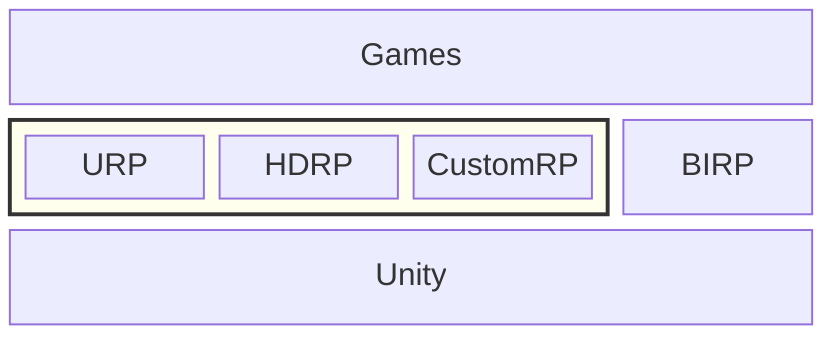

+++
title = "领读URP 001: 为什么我们需要阅读URP源码?"
date = 2025-04-26T14:10:07+08:00
lastmod = 2025-04-30T10:31:25+08:00
tags = ["Unity", "URP"]
categories = ["领读URP"]
draft = true
+++

Unity推出Universal Render Pipeline(通用渲染管线, 通常简称为URP)已经数年(???)了, 时至2025年, 已经被越来越多的项目所使用.
从Unity 6.0(???)开始, URP也成为Unity默认安装的项目模版, Built-In Render Pipeline(内置渲染管线, 通常简称为BIRP)
做为多年来默认的项目模版反倒需要手动下载才能使用.

## SRP, URP, HDRP, CustomRP, BIRP {#srp-urp-hdrp-customrp-birp}

## BIRP {#birp}

-   Unity6后已经不是默认创建项目使用的管线

### 优点 {#优点}

### 缺点 {#缺点}

-   性能不佳, 一种渲染管线照顾所有机型(性能有高有低, 高端Destop 5090, 低端千元手机)
-   仅能通过自定义shader控制渲染管线???(Shader+CommandBuferf???)

## SRP {#srp}

-   LWRP
-   URP
-   HDRP
-   未来URP和HDRP融合
-   自定义SRP或者修改URP/HDRP源码, 深度定制

## URP {#urp}

-   URP如何照顾所有机型?
-   URP拥有源码, 可以方便修改定制, BIRP不方便定制(怎么定制BIRP??)
-   相比BIRP如何实现高性能?
    -   架构方面
        1.  模块化可编程架构
        2.  显式的渲染循环控制
    -   渲染技术
        1.  单Pass前向渲染
            URP前向渲染管线, 在单Pass中, 处理最多8个逐像素光源(这是什么?), 所有光源在一个Pass内整合处理,
            减少了因光源数量增加而导致的Draw Call的增长, (内置管线如何做一个demo对比??)
        2.  Tile-Based阴影剔除
        3.  级联阴影和屏幕空间阴影混合(??缩写是什么?)
    -   资源管理
        1.  SRP Batch
        2.  Render Graph
        3.  减少Shader变体数量(如何减少??
    -   多相机处理
        相机堆栈概念, 减少冗余计算. (重复阴影计算等)
    -   其他
        1.  后处理按需处理
            Volume框架,
        2.  跨平台兼容性优化
            URP跨平台抽象层(???源码如何体现), 自动处理不同API的纹理格式, Uniform绑定差异,
            UniversalTarget编译宏简化多平台Shader开发(有没有Demo???)
        3.  Depth Prepass
            URP中将所有物体深度渲染到一张RT, 供后续使用.
            内置管线渲染到屏幕空间并在屏幕空间计算(怎么理解???)

## 优点 {#优点}

学习官方写法, 自己写package时, 可以有思路的参考作用.

## 参考 {#参考}

-   <https://blog.csdn.net/oWanMeiShiKong/article/details/146176078> Unity Built-in与URP渲染管线的本质原理对比与分析
-   <https://blog.51cto.com/u_16213678/13333614> Unity URP 项目的优缺点 转载
-   <https://portal.productboard.com/8ufdwj59ehtmsvxenjumxo82/tabs/3-Universal-render-pipeline> URP路线图
